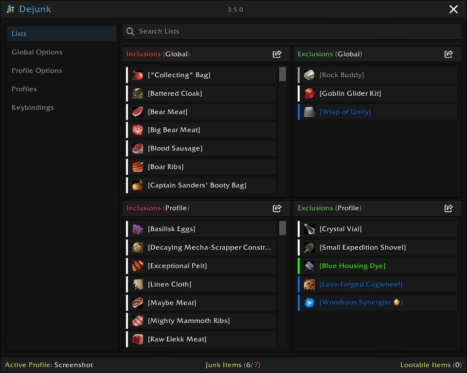
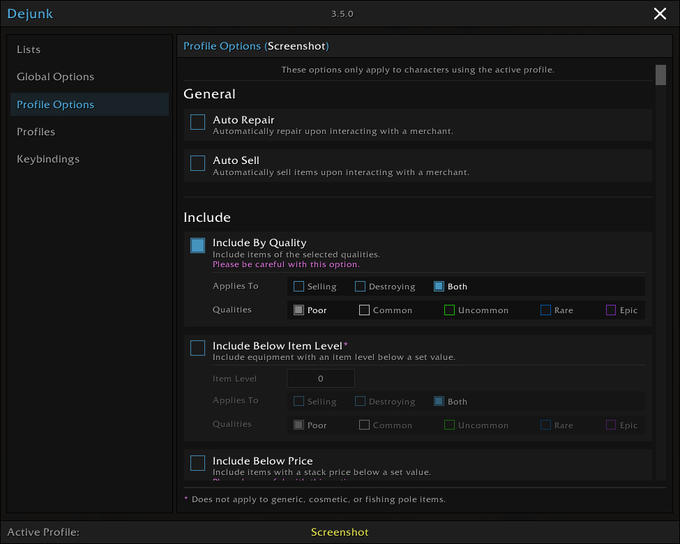
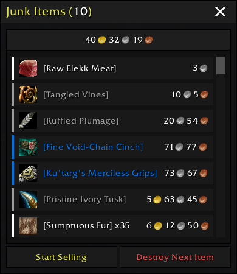
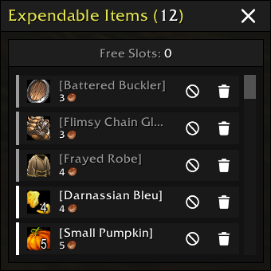
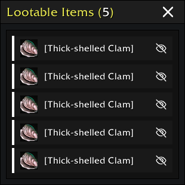
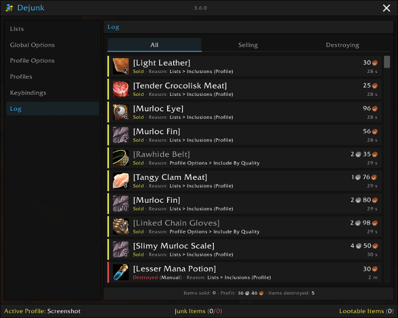

# Dejunk

Dejunk is an addon for World of Warcraft that helps determine which items are considered junk based on options and lists, then allows selling them in bulk or destroying them one at a time.



[Getting Started](#getting-started) · [Profile Options and Lists](#profile-options-and-lists) · [Junk Items](#junk-items) · [Expendable Items](#expendable-items) · [Lootable Items](#lootable-items) · [Log](#log) · [Keybindings and Commands](#keybindings-and-commands)

## Features

- Options and lists decide what is junk, separately for each profile, and characters can share a profile
- Tooltips and a log show why an item is considered junk
- A frame lists your junk with its sell value, with buttons to sell, exclude, or destroy each item
- A second frame lists your cheapest items to destroy when your bags are full
- Lootable items open one at a time from their own frame
- Sell automatically at merchants, repair equipment, and mark junk in your bags with icons

## Compatibility

Dejunk works on Retail, Mists of Pandaria Classic, TBC Classic, Classic Era, and WoW Forever. Some options are not available everywhere: `Include Artifact Relics` and `Exclude Warband Equipment` are Retail only, and `Exclude Equipment Sets` is not available on Classic Era or TBC Classic.

## Getting Started

Out of the box, only poor-quality items are junk, and nothing is sold automatically. To set it up:

1. **Add items to lists.** Left-click the minimap icon to open the main window, then open `Lists`. Drop an item into `Inclusions (Profile)` to consider it junk, or into `Exclusions (Profile)` to never consider it junk. The `Global` lists do the same for every character.
2. **Set the broader rules.** Open `Profile Options` to decide what is junk by quality, item level, price, or equipment type, and to exclude items such as quest items. `Include By Quality` is on for poor-quality items.
3. **Open the Junk Items frame.** Click the junk item counts in the footer of the main window, which show how many items can be sold and destroyed. The frame lists the junk items you currently possess, so you can see the result of your lists and options. Mouse over an item in your bags to see whether it would be sold or destroyed, and why.
4. **Keep an item.** In the Junk Items frame, click an item's Exclude button to add it to your `Exclusions`, so it is no longer considered junk. Dropping an item into the frame adds it to your `Inclusions`.
5. **Sell your junk.** At a merchant, click the button on the merchant frame to sell all of it, or the Sell button on an item in the Junk Items frame to sell only that item.
6. **Let it run by itself.** Turn on `Auto Sell` in `Profile Options` to sell as soon as a merchant opens, and `Auto Junk Frame` in `Global Options` to show the Junk Items frame at a merchant when you have junk items.

If the minimap icon is hidden, `/dejunk` opens the main window and `/dejunk help` lists every command. Frames can be dragged to move them, and Shift+right-click resets a frame's position.

## Profile Options and Lists

Two things decide what is junk:

- **Profile Options** — Include items by quality, item level, price, or equipment type, and exclude items you want to keep, such as quest items and equipment sets
- **Lists** — Put specific items on an `Inclusions` list to consider them junk, or on an `Exclusions` list to never consider them junk. `Global` lists apply to every character, and `Profile` lists apply to the active profile and take precedence over the global ones

A profile holds a character's options and lists, and characters can share one, so you can set up once and reuse it. A list can be exported as item IDs and imported into another list. See [How Dejunk Decides What Is Junk](#how-dejunk-decides-what-is-junk) for the order they are checked in.



## Junk Items

The Junk Items frame lists the junk items you currently possess, with their total sell value, so you can check what Dejunk would sell before it does.

- Each item has Sell, Exclude, and Destroy buttons
- Drop an item into the frame to add it to `Inclusions (Profile)`
- Hold Shift while dropping an item, or clicking Exclude, to use the `Global` list instead
- Ctrl+Alt+right-click the bar that shows the total value to add every listed item to `Exclusions (Profile)`
- An item you can still refund is listed, but selling skips it. Destroying it works

Open it with:

- A click on the junk item counts in the footer of the main window
- A right-click on the minimap icon
- A right-click on the merchant button, at a merchant
- The `Auto Junk Frame` option, which shows it at a merchant when you have junk items
- `/dejunk junk`
- A keybinding

Alt+right-click on the minimap icon or the merchant button destroys the next junk item instead.



## Expendable Items

Use the Expendable Items frame to quickly destroy your cheapest bag items to free up space, such as when your bags are full and you cannot loot something. It lists items cheapest stack first, with a Destroy button on each.

It lists items differently from the Junk Items frame, which lists only junk:

- Junk items always show, with a black and white icon
- Items excluded from destroying never show
- Everything else shows only if its type and quality are selected in its `Types` and `Qualities` options. By default, that is poor and common quality equipment, trade goods, and consumables

Open it with:

- A click on the `Expendable Items Frame` card in `Global Options`, which also has its options
- The `Auto Show` option, which by default shows it when your bags are full while the loot window is open
- `/dejunk expendable`
- A keybinding



## Lootable Items

The Lootable Items frame lists items in your bags that open when right-clicked, such as clams. Click an item in the frame to open it.

Open it with:

- A click on the lootable item count in the footer of the main window
- The `Auto Lootable Frame` option, which shows it when you have items to loot
- `/dejunk loot`
- A keybinding



## Log

The `Log` screen lists what Dejunk sold or destroyed this session, newest first, with the reason each item was junk and its value. It is not saved, so a reload clears it.

Open it with:

- The `Log` row in the sidebar of the main window
- `/dejunk log`



## Keybindings and Commands

The `Keybindings` screen sets keys for the frames, `Start Selling`, and `Destroy Next Item`. It also sets a key for each list that adds the item shown in the game tooltip to the list, or removes it if the list already has it, so mouse over an item and press the key.

- Click a row, then press a key, a mouse button other than left or right, or the mouse wheel to bind it. Escape cancels
- Right-click a row to unbind it
- Keys set here take priority over the game's own keybindings

The chat commands are:

- `/dejunk` — Toggle the main window
- `/dejunk sell` — Start selling junk items
- `/dejunk destroy` — Destroy the next junk item
- `/dejunk junk` — Toggle the junk frame
- `/dejunk loot` — Toggle the lootable items frame
- `/dejunk expendable` — Toggle the expendable items frame
- `/dejunk log` — Toggle the log screen
- `/dejunk profiles` — Toggle the profiles screen
- `/dejunk help` — Display a list of commands

## How Dejunk Decides What Is Junk

An item is checked against the options and lists in this order, and the first match decides:

1. `Exclude Above Item Level` and `Exclude Above Price`, when enabled
2. `Exclusions (Profile)`
3. `Inclusions (Profile)`
4. `Exclusions (Global)`
5. `Inclusions (Global)`
6. The other `Exclude` options
7. The `Include` options

In short, a profile's lists come before the global lists, and exclusions come before inclusions at each level. An item that matches nothing is not junk, and an item with no vendor price is never junk for selling.

## Developer API

Dejunk exposes a public API for other addons to integrate with.

```lua
-- Subscribe to bag cache and state change events.
local removeListener = DejunkApi:AddListener(function(event)
  if event == DejunkApi.Events.BagsUpdated then ... end
  if event == DejunkApi.Events.StateUpdated then ... end
end)

-- Check whether an item is considered junk.
local isJunk = DejunkApi:IsJunk(bagId, slotId)
```

## Credit

### Art

- [Cash icon](https://game-icons.net/1x1/lorc/cash.html) by [Lorc](http://lorcblog.blogspot.com/) under [CC BY 3.0](http://creativecommons.org/licenses/by/3.0/).
- [FontAwesome](https://fontawesome.com/) under [CC BY 4.0](https://creativecommons.org/licenses/by/4.0/)

### Libraries

- [CallbackHandler-1.0](https://www.wowace.com/projects/callbackhandler)
- [LibDataBroker-1.1](https://www.wowace.com/projects/libdatabroker-1-1)
- [LibDBIcon-1.0](https://www.wowace.com/projects/libdbicon-1-0)
- [LibStub](https://www.wowace.com/projects/libstub)
- [Waffle](https://github.com/moody/Waffle)
- [Wux](https://github.com/moody/Wux)

## License

[MIT](LICENSE)
