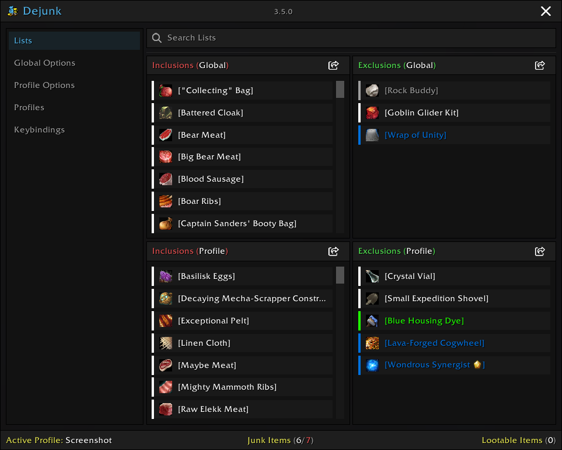
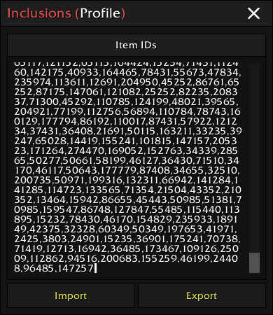
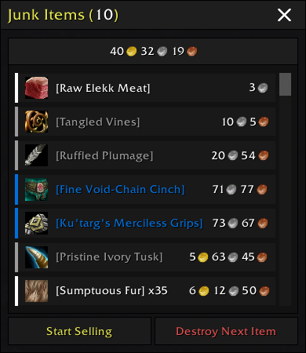
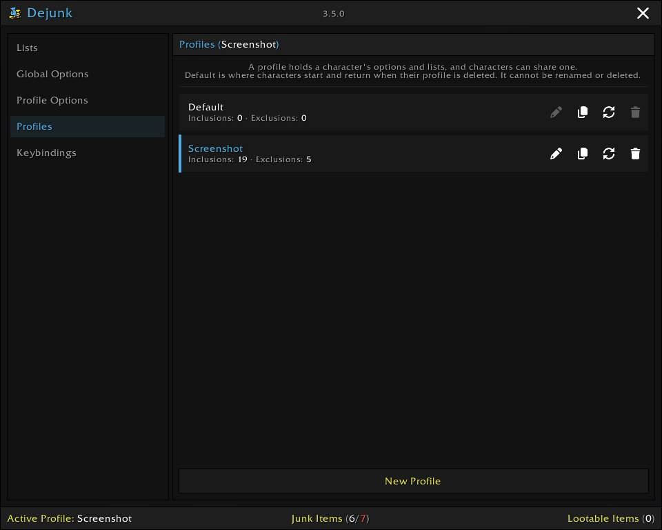
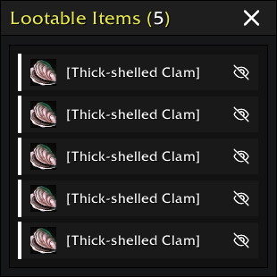
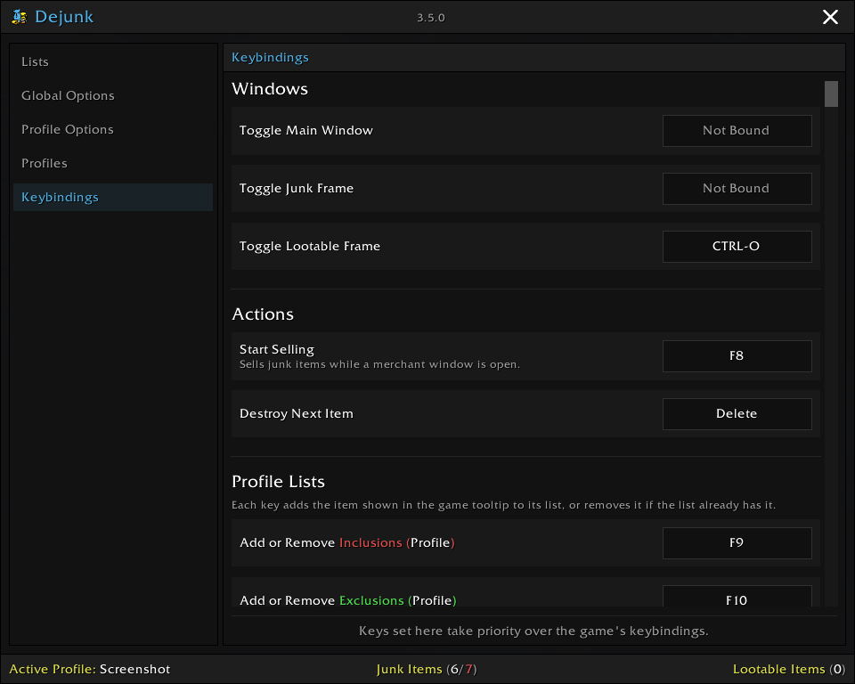

# Dejunk

Dejunk is an addon for World of Warcraft that helps determine which items are considered junk based on options and lists, then allows selling them in bulk or destroying them one at a time.



## Features

- Sell junk automatically or on demand
- Destroy junk one at a time, with optional confirmation
- Separate settings and lists per profile, shareable across characters
- Tooltips explain why an item is considered junk
- Auto-repair equipment at merchants
- Overlay icons on junk in your bags
- Open lootable items one at a time from a dedicated frame
- Use keybindings or chat commands for most actions

### Getting Started

Out of the box, only poor-quality items are junk, and nothing is sold automatically. Open a merchant and click the merchant button, or run `/dejunk sell`, to sell the junk. Turn on `Auto Sell` in `Profile Options` to sell as soon as a merchant opens. Check the Junk Items frame (`/dejunk junk`) first to see what would be sold, and run `/dejunk` to open the options.

### Profile Options

The `Profile Options` screen has three groups. `General` holds `Auto Repair` and `Auto Sell`. `Include` and `Exclude` determine what is considered junk, and most of their options have per-quality checkboxes that limit them to specific quality tiers.

#### Include

- **Include Artifact Relics** — Include artifact relic gems _(Retail only)_
- **Include By Quality** — Include items by quality tier (poor quality included by default)
- **Include Below Item Level** — Include equipment below a set item level
- **Include Below Price** — Include items with a stack price below a set value
- **Include By Equipment Type** — Include equipment of the selected armor and weapon types (cloaks never match)

#### Exclude

- **Exclude Above Item Level** — Exclude equipment above a set item level, even if it is on an Inclusions list
- **Exclude Above Price** — Exclude items with a stack price above a set value, even if it is on an Inclusions list
- **Exclude By Equipment Type** — Exclude equipment of the selected armor and weapon types (cloaks never match)
- **Exclude Equipment Sets** — Exclude equipment saved to an equipment set _(Not available on Classic Era or TBC Classic)_
- **Exclude Unbound Equipment** — Exclude equipment that is not yet bound
- **Exclude Warband Equipment** — Exclude equipment eligible for the warband bank _(Retail only)_

Each `Include` and `Exclude` option applies to selling, destroying, or both. They start on both, except `Include Below Price` on selling and `Exclude Above Price` on destroying. `Include By Quality` and `Exclude Equipment Sets` are on by default, and every other option is off.

The price options compare the price of the whole stack and never affect items with no vendor price.

### Global Options

The `Global Options` screen applies to every character, regardless of profile.

- **Safe Destroy** — Require confirmation before destroying an item
- **Safe Sell** — Only sell up to 12 items at a time
- **Merchant Button** — Add a button to the merchant window
- **Minimap Icon** — Add an icon to the minimap
- **Auto Junk Frame** — Show the Junk Items frame automatically at a merchant
- **Auto Lootable Frame** — Show the Lootable Items frame automatically
- **Chat Messages** — Print messages to chat
- **Bag Item Tooltips** — Add Dejunk information to the tooltips of items in your bags
- **Bag Item Icons** — Overlay a small or large icon on junk items in your bags

Everything is off by default except `Safe Destroy`, `Chat Messages`, `Bag Item Tooltips`, `Merchant Button`, and `Minimap Icon`.

The merchant button sells on left-click, toggles the Junk Items frame on right-click, destroys the next item on Alt+right-click, and resets its position on Shift+right-click. The minimap icon toggles the main window on left-click, toggles the Junk Items frame on right-click, and destroys the next item on Alt+right-click.

### Lists

Inclusions and Exclusions lists are available at both the global and per-profile level.

- **`Inclusions (Global)`** — Considered junk across all characters
- **`Exclusions (Global)`** — Never considered junk across all characters
- **`Inclusions (Profile)`** — Considered junk for the active profile only
- **`Exclusions (Profile)`** — Never considered junk for the active profile only

An item is checked in this order, and the first match decides:

1. `Exclude Above Item Level` and `Exclude Above Price`, when enabled
2. `Exclusions (Profile)`
3. `Inclusions (Profile)`
4. `Exclusions (Global)`
5. `Inclusions (Global)`
6. The other `Exclude` options
7. The `Include` options

An item that matches nothing is not junk, and an item with no vendor price is never junk for selling.

Items can be added to lists by dropping them into the list frame or the Junk Items frame, or with the list keybindings.

### Import/Export

Each list has its own Import/Export frame, opened from a button on the list frame itself. It shows the list's item IDs as plain text, ready to copy out. Paste in a new set of IDs and click `Import` to add them to the list, or click `Export` to refill the box with the list's current IDs.



### Junk Items

The Junk Items frame, opened via `/dejunk junk`, its keybind, a click on the junk item counts in the footer of the main window, or a right-click on the merchant button or the minimap icon, lists items currently considered junk along with their total sell value. The gear button in its title bar toggles the main window.

- Each item has three buttons:
  - **Sell** (coins icon) — Sells the item. Dimmed while it cannot be sold right now, such as away from a merchant
  - **Destroy** (trash can icon) — Destroys the item. Dimmed while it cannot be destroyed
  - **Exclude** (ban icon, a circle with a slash) — Adds the item to an Exclusions list, or the global one while holding Shift
- Sell and destroy work on any listed item, even one that is junk only for the other action. Their tooltips show whether the item is being sold or destroyed, and why. While dimmed, they ignore clicks
- Drop an item into the frame to add it to an Inclusions list, or the global one while holding Shift
- Ctrl+Alt+right-click the bar that shows the total value to add every listed item to an Exclusions list, or the global one while holding Shift
- A locked item, such as one on the cursor or in a trade, stays listed but dimmed, shows `Item is locked` in place of its price, and cannot be clicked until it unlocks
- An item you can still refund is listed, but selling skips it; its tooltip says why, and destroying it works
- `Start Selling`, available at a merchant, and `Destroy Next Item` act on the listed items that are junk for selling and destroying, respectively

The `Auto Junk Frame` option shows the frame automatically at a merchant when you have junk items, and closes it when you have none left or leave the merchant.



### Profiles

Each character is assigned a profile, which holds its own `Inclusions (Profile)` and `Exclusions (Profile)` lists along with its own copy of the auto-sell, auto-repair, and junk-detection options. Multiple characters can share the same profile.

Every character starts on the `Default` profile. Profiles are created, duplicated, activated, renamed, reset, and deleted on the `Profiles` screen of the main window, which `/dejunk profiles` also toggles. The footer shows the active profile; click it to open the `Profiles` screen. Duplicating a profile copies its options and lists into a new profile and switches to it. Resetting a profile returns its options and lists to their defaults. The `Default` profile cannot be renamed or deleted, and characters using a deleted profile return to `Default`.



### Lootable Items

Lootable bag items, such as those that need to be right-clicked to open, are listed in the Lootable Items Frame, opened via `/dejunk loot`, its keybind, or a click on the lootable item count in the footer of the main window. Click an item to attempt to open it; a loot window may prompt for confirmation depending on your own auto-loot setting. Each item also has a button to ignore all instances of that item for the remainder of the session. The `Auto Lootable Frame` option shows the frame automatically whenever you have lootable items, and closes it once you have none; opening it manually with nothing to loot prints a message instead.



### Keybindings

The `Keybindings` screen of the main window sets keys for the Main Window, Junk Items, and Lootable Items frames, for `Start Selling` and `Destroy Next Item`, and for adding an item to each list, or removing it if it is already there. Click a row, then press a key, a mouse button other than left or right, or the mouse wheel to bind it. Escape cancels. Right-click a row to unbind it. The list actions use the item shown in the game tooltip, so mouse over an item and press the key.

- A key set here takes priority over the game's own binding for it, and a note names the binding it covers.
- Dejunk saves these keys itself, so they do not appear in the game's own Keybindings page.
- Keys cannot be changed in combat, and gamepad buttons cannot be bound.



## Chat Commands

```bash
# Toggle the main window.
/dejunk

# Start selling items.
/dejunk sell

# Destroy next item.
/dejunk destroy

# Toggle the junk frame.
/dejunk junk

# Toggle the lootable items frame.
/dejunk loot

# Toggle the profiles screen.
/dejunk profiles

# Display a list of commands.
/dejunk help
```

## Developer API

Dejunk exposes a public API for other addons to integrate with.

```lua
-- Subscribe to bag cache and state change events.
local removeListener = DejunkApi:AddListener(function(event)
  if event == DejunkApi.Events.BagsUpdated then ... end
  if event == DejunkApi.Events.StateUpdated then ... end
end)

-- Check whether an item is considered junk.
local isJunk = DejunkApi:IsJunk(bagId, slotId)
```

## Credit

### Art

- [Cash icon](https://game-icons.net/1x1/lorc/cash.html) by [Lorc](http://lorcblog.blogspot.com/) under [CC BY 3.0](http://creativecommons.org/licenses/by/3.0/).
- [FontAwesome](https://fontawesome.com/) under [CC BY 4.0](https://creativecommons.org/licenses/by/4.0/)

### Libraries

- [CallbackHandler-1.0](https://www.wowace.com/projects/callbackhandler)
- [LibDataBroker-1.1](https://www.wowace.com/projects/libdatabroker-1-1)
- [LibDBIcon-1.0](https://www.wowace.com/projects/libdbicon-1-0)
- [LibStub](https://www.wowace.com/projects/libstub)
- [Waffle](https://github.com/moody/Waffle)
- [Wux](https://github.com/moody/Wux)

## License

[MIT](LICENSE)
